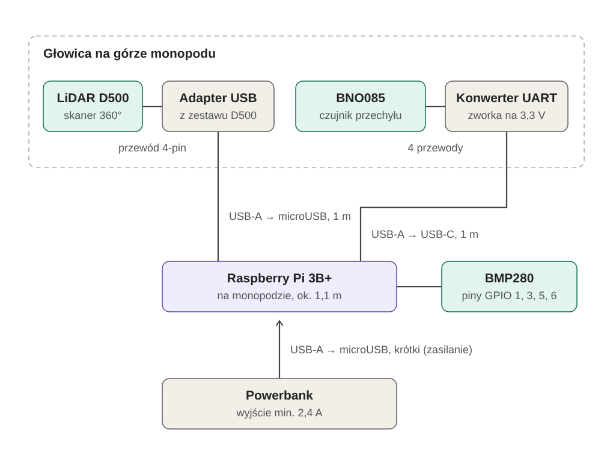
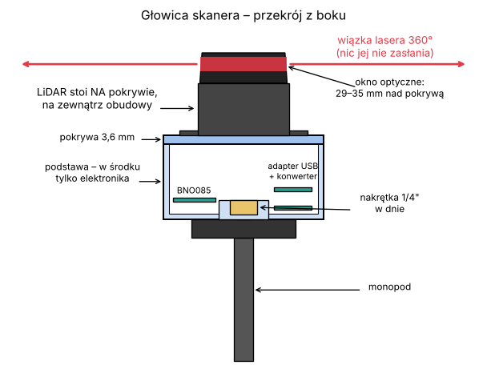

# Skaner 2D na Raspberry Pi 3B+ — instrukcja

Zestaw: LiDAR D500 (LDROBOT STL-19P), czujnik przechyłu BNO085, barometr BMP280, Raspberry Pi 3B+, powerbank, monopod z gwintem 1/4".

## 1. Schemat połączeń



### Kable USB

| Nr | Skąd | Dokąd | Kabel |
|---|---|---|---|
| 1 | Powerbank | Raspberry Pi, gniazdo zasilania | USB-A → microUSB, krótki i gruby |
| 2 | Raspberry Pi, port USB | Adapter USB LiDAR-u (w głowicy) | USB-A → microUSB, ok. 1 m, z liniami danych |
| 3 | Raspberry Pi, port USB | Konwerter UART (w głowicy) | USB-A → USB-C, ok. 1 m, z liniami danych |

LiDAR łączy się ze swoim adapterem przewodem 4-pin z zestawu.

### BNO085 → konwerter UART (tryb UART-RVC)

| BNO085 | Konwerter CH343 (zworka na 3,3 V) |
|---|---|
| VIN | VCC (3,3 V) |
| GND | GND |
| SDA | RXD |
| P0 | zwarty z pinem 3Vo na płytce BNO085 |

Rozkład pinów trybu UART-RVC nie był sprawdzony na fizycznej płytce — przed podłączeniem porównaj z dokumentacją Adafruit.

### BMP280 → Raspberry Pi (złącze GPIO)

| BMP280 | Pin Raspberry Pi |
|---|---|
| VCC | 1 (3,3 V) |
| SDA | 3 |
| SCL | 5 |
| GND | 6 |

Barometr zostaje przy Raspberry Pi, na przewodach 10–20 cm (magistrala I2C źle znosi długie przewody).
Nie zaklejaj otworu czujnika, nie wystawiaj go na nawiew ani słońce.

## 2. Głowica i mocowanie



LiDAR stoi **na pokrywie**, poza obudową — okno optyczne musi być odsłonięte dookoła. W pudełku pod spodem
są BNO085 (płasko, sztywno przykręcony), adapter USB LiDAR-u i konwerter UART. Całość nakręca się na gwint 1/4" monopodu.


Pliki do druku i lista śrub: katalog [`obudowa/`](obudowa/README.md).

Raspberry Pi i powerbank przypnij rzepami do monopodu na wysokości ok. 1,0–1,2 m; kable USB poprowadź po rurze i przypnij opaskami.

## 3. Instalacja na Raspberry Pi (jednorazowo)

```bash
sudo apt update
sudo apt install -y python3-serial python3-smbus2 python3-matplotlib i2c-tools tmux git
sudo raspi-config                      # Interface Options → I2C → Enable
sudo usermod -aG dialout,i2c $USER     # potem wyloguj się i zaloguj ponownie
git clone https://github.com/Anakreont/GOLlidar.git ~/skaner
```

Autostart po włączeniu zasilania:

```bash
sudo cp ~/skaner/skaner.service /etc/systemd/system/
sudo systemctl daemon-reload
sudo systemctl enable --now skaner
```

Plik `skaner.service` zakłada użytkownika `anakreont` i katalog `/home/anakreont/skaner` — przy innym loginie popraw trzy linie.

Sprawdzenie barometru po podłączeniu: `i2cdetect -y 1` powinno pokazać `76` albo `77`
(dla `77` dopisz w `skaner.service` do linii `ExecStart` opcję `--baro-adres 0x77`).

## 4. Aktualizacja i polecenia

| Co | Polecenie |
|---|---|
| Pobrać aktualizację i zrestartować | `~/skaner/start.sh` |
| Stan usługi | `systemctl status skaner --no-pager` |
| Komunikaty i błędy | `journalctl -u skaner -n 30 --no-pager` |
| Zatrzymać / wyłączyć autostart | `sudo systemctl stop skaner` / `sudo systemctl disable --now skaner` |

Przy włączonej usłudze nie uruchamiaj `python3 skan_web.py` ręcznie — druga kopia trafi na zajęty port 8080.

## 5. Sieć w terenie

Dodaj hotspot telefonu jako znaną sieć (hasło wpisz sam):

```bash
sudo nmcli connection add type wifi ifname wlan0 con-name hotspot-telefon ssid "NAZWA_HOTSPOTU" wifi-sec.key-mgmt wpa-psk wifi-sec.psk "HASLO" connection.autoconnect yes connection.autoconnect-priority 5
```

W terenie: włącz hotspot, podłącz powerbank, odczekaj ok. minuty. Stronę otwierasz pod `http://rpimax.local:8080`
albo pod adresem IP z listy urządzeń podłączonych do hotspotu, z dopiskiem `:8080`.

## 6. Strona w telefonie

- **Pasek na górze**: zapis z czasem, LiDAR (ok. 10 Hz), przechył, wysokość względna.
- **Podgląd**: bieżący obrót LiDAR-u, czyli kontur pomieszczenia wokół czujnika.
- **START / STOP**: początek i koniec sesji; nazwa sesji np. `poziom_0_A`.
- **PAUZA**: naciśnij przed schyleniem się lub kucnięciem, po wyprostowaniu WZNÓW. Dane zapisują się dalej,
  odcinek jest oznaczony do pominięcia. Wznawiaj w tym samym miejscu i w tę samą stronę.
  Przechył powyżej 15° jest oznaczany automatycznie („PRZECHYŁ").
- **Znacznik / notatka**: tekst przypisany do miejsca i czasu; szybkie znaczniki jednym dotknięciem.
- **Pomieszczenie – oświetlenie**: nazwa pomieszczenia, rodzaj oprawy (świetlówki, LED, żarówki, inne),
  punktów świetlnych w oprawie, ilość opraw, uwagi. Zapis trafia do `pomieszczenia.csv` (otwiera się w Excelu)
  i stawia znacznik, więc pomieszczenie zostanie podpisane na rzucie. Kilka rodzajów opraw w jednej sali = osobne wiersze.
- **Zeruj wysokość**, **Wyłącz RPi**: na dole strony. Przed odpięciem powerbanku zawsze użyj „Wyłącz RPi".

## 7. Jak chodzić

1. Czujnik na stałej wysokości, monopod pionowo, tempo ok. 0,5 m/s, obroty powoli (pełny obrót w 5–6 s).
2. Każdą kondygnację zaczynaj i kończ na tym samym spoczniku klatki schodowej. Z barometrem można nagrywać ciągle;
   bez niego każda kondygnacja to osobna sesja.
3. Przed startem otwórz drzwi do sal. W każdej sali dojdź do środka, stań na 2–3 s i zapisz pomieszczenie lub znacznik.
4. Na początku i końcu nagrania postój 5 s bez ruchu.
5. Na długich korytarzach wchodź do sal po obu stronach. Salę gimnastyczną obejdź dookoła 3–4 m od ścian.
6. Na każdej kondygnacji zmierz dalmierzem 3–4 długie wymiary kontrolne oraz grubość ściany zewnętrznej w ościeżu okna.
7. Skanuj po lekcjach — ludzie w kadrze psują mapę.

### Budynki, kondygnacje, pomieszczenia, poprawki

- Przed START wybiera się **budynek** z listy wcześniej użytych albo wpisuje nowy, oraz **kondygnację** (skróty: piwnica, parter,
  1 piętro…). Obie wartości trafiają do `info.txt` i do każdego wiersza `pomieszczenia.csv`.
- W trakcie nagrywania kondygnację zmienia się przyciskiem **Zmień** (znacznik `KONDYGNACJA …`), bez przerywania nagrania.
- Formularz oświetlenia: 1. liczba opraw, 2. liczba punktów w oprawie, 3. moc punktu. Liczba opraw 0 zapisuje samo pomieszczenie.
  Nazwę można pominąć — wpis dostaje nazwę „bez nazwy N", a miejsce i tak wyznacza czas w nagraniu.
- **Zapisane dane** są pogrupowane: budynek → kondygnacje (nagrania). Przy budynku suma nagrań, pomieszczeń, opraw i mocy
  oraz **Usuń budynek**; przy nagraniu **Podgląd** i **Usuń** (zawsze z podwójnym potwierdzeniem; aktywnego nagrania usunąć się nie da).
- W podglądzie każdy wpis pomieszczenia i każdy ręczny znacznik ma **Edytuj** i **Usuń**. Pliki są tylko dopisywane:
  poprawka to nowy wiersz z tym samym `czas_ns` i `wpis=poprawka` (obowiązuje ostatni), usunięcie to `wpis=usuniety`;
  w `znaczniki.txt` są to wiersze `EDYCJA <id> <tekst>` i `USUNIETO <id>`. Dzięki temu kopia na serwer zawsze się zgadza.
- Usuwanie z karty nie usuwa kopii na serwerze.

### Grzejniki, wysokość w świetle, klimatyzacja

- Zakładka **Grzejniki**: rodzaj (żeliwny, płytowy, aluminiowy, łazienkowy, rurowy, favier), sztuk, liczba żeberek w jednym
  albo szerokość i długość w cm, uwagi. Zapis do `grzejniki.csv`, poprawki i usuwanie jak przy pomieszczeniach.
  Nazwa pomieszczenia jest wspólna z zakładką Oprawy i zostaje do zmiany.
- Zakładka **Notatka**: szybkie wpisy „Wysokość w świetle" i „Klimatyzacja" zapisują się jako znaczniki
  (`WYSOKOŚĆ W ŚWIETLE 285 cm (sala 12)`, `KLIMATYZACJA …`).
- Po dodaniu nowych rodzajów plików trzeba raz odświeżyć odbiornik na serwerze:
  `git -C ~/GOLlidar pull && cp ~/GOLlidar/serwer/lidar_upload.py ~/BMS/ && sudo systemctl restart bms-api`.

### Okna i drzwi zewnętrzne, punkty na podglądzie

- Zakładka **Okna**: rodzaj, szerokość × wysokość, rama, szyby, sztuk. Litera typu nadaje się sama — te same cechy to ten sam typ
  w całym budynku; użyte typy są na górze jako skróty z liczbą sztuk. Zapis do `okna.csv`.
- **Punkt na podglądzie**: podczas nagrywania dotknięcie mapy w zakładce Skan zaznacza miejsce (przyciąga do najbliższego
  pomiaru w promieniu 35 cm); po wpisaniu opisu i średnicy powstaje znacznik `PUNKT kat=… odl=… pion c.o. Ø50`,
  czyli położenie względem skanera w tej chwili. Stać nieruchomo od dotknięcia do zapisu.

### Zdjęcia i drugi LiDAR

- **Zdjęcia**: podczas nagrywania w prawym dolnym rogu jest przycisk aparatu. Zdjęcie jest zmniejszane w telefonie
  (dłuższy bok 1600 px), zapisywane w sesji jako `foto_GGMMSS_NNN.jpg` i oznaczane znacznikiem `FOTO … (pomieszczenie)`,
  więc przypina się do miejsca w skanie. Podgląd: zakładka Dane → Podgląd nagrania → Zdjęcia. Idą też na serwer.
- **Drugi LiDAR (pionowy)**: drugi D500 wpięty do USB jest wykrywany przy starcie usługi (`/dev/ttyUSB1`) i nagrywany do
  `lidar2.bin`. W zakładce Dane jest jego stan i przycisk „Zamień poziomy / pionowy" — podgląd w zakładce Skan ma pokazywać
  LiDAR poziomy (obrys pomieszczenia). Wybór jest pamiętany.

### Przekrój pionowy (wysokości) — automatycznie

W trakcie nagrywania można w dowolnym miejscu zmierzyć pionowy przekrój pomieszczenia:

1. Stanąć i położyć monopod poziomo (przechył 60–125°), tak żeby płaszczyzna skanu przecinała to, co ma być zmierzone
   (np. w poprzek sali albo prostopadle do ściany z oknem).
2. Trzymać nieruchomo. Strona pokazuje odliczanie, po 3 s jest podwójny sygnał, wibracja i napis „PRZEKRÓJ nr N ZAPISANY"
   z szacunkowymi wymiarami (np. `3,04 × 6,20 m` — wysokość i szerokość).
3. Postawić monopod do pionu, odczekać sekundę i iść dalej. Nic nie trzeba klikać; przekrojów może być dowolnie wiele.

Poruszenie w trakcie zaczyna odliczanie od nowa; podniesienie przed sygnałem anuluje pomiar (niski dźwięk).
W `znaczniki.txt` zapisują się `PRZEKROJ_START`, `PRZEKROJ_OK nr=…`, `PRZEKROJ_WYNIK`, `PRZEKROJ_KONIEC`.
Wymiary na stronie są tylko podglądem; dokładne przekroje (parapety, nadproża, grzejniki) liczone są później z nagrania.
Dźwięk działa po pierwszym dotknięciu strony w telefonie; wymaga czujnika przechyłu.

## 8. Pliki nagrania

Katalog `~/skany/<data>_<nazwa>/`:

| Plik | Zawartość |
|---|---|
| `lidar.bin`, `imu.bin`, `baro.bin` | surowe dane czujników ze znacznikami czasu |
| `znaczniki.txt` | znaczniki, pauzy, automatyczne oznaczenia przechyłu |
| `pomieszczenia.csv` | inwentaryzacja oświetlenia |
| `info.txt` | parametry sesji |

Kontrola nagrania: `python3 ~/skaner/sprawdz.py ~/skany/<katalog> --png`.
Godzina nagrania to ok. 80 MB. Zestaw pobiera ok. 4–4,5 W; powerbank 10 000 mAh wystarcza na ok. 5,5 h.

## 9. Kopia nagrań na serwer w trakcie pracy

`sync.sh` co minutę wysyła nowe dane z `~/skany/` na serwer. Wysyłana jest tylko nowa końcówka rosnących plików
(ok. 80 MB na godzinę nagrania). Stan kopii widać na stronie w sekcji „Stan". Dane zawsze najpierw trafiają na kartę SD;
kopia jest dodatkowym zabezpieczeniem i przy braku zasięgu sama nadrabia zaległości.

### Kopia na pendrive (bez sieci, zalecana zawsze)

Zwykły pendrive (FAT32 lub exFAT) wpięty w Raspberry Pi; co minutę dopisywane są na niego nowe dane. Chroni przed
uszkodzeniem karty SD także tam, gdzie nie ma zasięgu.

```bash
sudo mkdir -p /media/pendrive
echo "/dev/sda1 /media/pendrive auto nofail,noatime,uid=$(id -u),gid=$(id -g) 0 0" | sudo tee -a /etc/fstab
sudo mount /media/pendrive && df -h /media/pendrive
cd ~/skaner && [ -f sync.conf ] || cp sync.conf.example sync.conf
nano sync.conf                                   # odkomentowac PENDRIVE="/media/pendrive"
./sync.sh && cat ~/skany/.sync_pendrive          # czas i OK
sudo cp skaner-sync.service skaner-sync.timer /etc/systemd/system/
sudo systemctl daemon-reload && sudo systemctl enable --now skaner-sync.timer
```

Pendrive wpinać przed włączeniem maliny. Strona pokazuje stan w kafelku „Kopia na pendrive" (OK / BRAK PENDRIVE / BŁĄD).
Kopia na pendrive i kopia na serwer działają niezależnie; można mieć obie.

### Wariant A (zalecany): HTTPS do BMS API przez istniejący tunel

Raspberry Pi wysyła dane zwykłym HTTPS na adres API — nie potrzeba SSH, VPN ani tunelu na samej malinie.

**Na serwerze (jednorazowo):**
1. Skopiować `serwer/lidar_upload.py` do katalogu z `api_server.py` i dopisać w `api_server.py`:
   ```python
   from lidar_upload import router as lidar_router
   app.include_router(lidar_router)
   ```
2. Wygenerować token (`openssl rand -hex 32`) i ustawić w środowisku usługi API: `LIDAR_TOKEN=...` oraz
   `LIDAR_DIR=/sciezka/na/nagrania`. Zrestartować usługę API.

**Na Raspberry Pi (jednorazowo):**
```bash
cd ~/skaner && cp sync.conf.example sync.conf && nano sync.conf     # URL i TOKEN
chmod 600 sync.conf
./sync.sh && cat ~/skany/.sync_status                               # powinno wypisać czas i OK
sudo cp skaner-sync.service skaner-sync.timer /etc/systemd/system/
sudo systemctl daemon-reload && sudo systemctl enable --now skaner-sync.timer
```

Token wpisuje się tylko w `sync.conf` (plik nie trafia do repozytorium) i w środowisku usługi na serwerze.

### Wariant B: rsync przez SSH

Używany, gdy w `sync.conf` nie ma `URL`. Serwer musi być osiągalny po SSH (np. Tailscale), z kluczem bez hasła:
```bash
ssh-keygen -t ed25519 -N "" -f ~/.ssh/id_ed25519
ssh-copy-id uzytkownik@adres-serwera
```
W `sync.conf` ustawić `CEL` i ewentualnie `PORT`; włączenie timera jak wyżej.

### Wariant C: tunel Cloudflare na Raspberry Pi, serwer sam pobiera nagrania

Na malinie działa `cloudflared` (jak na innych malinach w terenie), a serwer co minutę pobiera nowe dane przez SSH w tunelu.
Dodatkowo jest zdalny dostęp SSH do skanera z dowolnego miejsca. Na malinie nie ma wtedy żadnego tokenu API ani `sync.conf`.

1. W panelu Cloudflare Zero Trust utworzyć nowy tunel i polecenie instalacyjne z panelu wkleić na malinie
   (architekturę pokazuje `dpkg --print-architecture`). Publiczny adres: `ssh-NAZWA.domena` -> `ssh://localhost:22`.
   **Strony skanera (port 8080) nie wystawiać publicznie bez Cloudflare Access** — nie ma logowania, a ma przyciski STOP i wyłączania.
2. Klucz SSH roota serwera wgrać na malinę (w domu, po sieci lokalnej): `sudo ssh-copy-id anakreont@ADRES-MALINY`.
   Zalecane wyłączenie logowania hasłem po SSH na malinie.
3. Na serwerze:
   ```bash
   sudo install serwer/pobierz_lidar.sh /usr/local/bin/
   sudo nano /etc/lidar-pobierz.conf            # HOST, UZYTKOWNIK, CEL (opis w skrypcie)
   sudo /usr/local/bin/pobierz_lidar.sh && echo OK
   sudo cp serwer/lidar-pobierz.service serwer/lidar-pobierz.timer /etc/systemd/system/
   sudo systemctl daemon-reload && sudo systemctl enable --now lidar-pobierz.timer
   ```
Po każdym udanym pobraniu serwer zapisuje na malinie potwierdzenie, które strona pokazuje w kafelku „Kopia na serwer".

## 10. Wariant zapasowy bez strony

```bash
sudo systemctl stop skaner
python3 ~/skaner/skan_log.py parter_A --imu /dev/ttyACM0 --baro
```

Enter zapisuje znacznik, Ctrl+C kończy nagranie.
