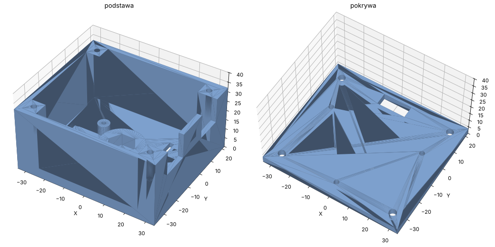

# Skaner 2D na Raspberry Pi 3B+ — instrukcja

Zestaw: LiDAR D500 (LDROBOT STL-19P), czujnik przechyłu BNO085, barometr BMP280, Raspberry Pi 3B+, powerbank, monopod z gwintem 1/4".

## 1. Schemat połączeń


### Kable USB

| Nr | Skąd | Dokąd | Kabel |
|---|---|---|---|
| 1 | Powerbank | Raspberry Pi, gniazdo zasilania | USB-A → microUSB, krótki i gruby |
| 2 | Raspberry Pi, port USB | Adapter USB LiDAR-u (w głowicy) | USB-A → microUSB, ok. 1 m, z liniami danych |
| 3 | Raspberry Pi, port USB | Konwerter UART (w głowicy) | USB-A → USB-C, ok. 1 m, z liniami danych |

LiDAR łączy się ze swoim adapterem przewodem 4-pin z zestawu.

### BNO085 → konwerter UART (tryb UART-RVC)

| BNO085 | Konwerter CH343 (zworka na 3,3 V) |
|---|---|
| VIN | VCC (3,3 V) |
| GND | GND |
| SDA | RXD |
| P0 | zwarty z pinem 3Vo na płytce BNO085 |

Rozkład pinów trybu UART-RVC nie był sprawdzony na fizycznej płytce — przed podłączeniem porównaj z dokumentacją Adafruit.

### BMP280 → Raspberry Pi (złącze GPIO)

| BMP280 | Pin Raspberry Pi |
|---|---|
| VCC | 1 (3,3 V) |
| SDA | 3 |
| SCL | 5 |
| GND | 6 |

Barometr zostaje przy Raspberry Pi, na przewodach 10–20 cm (magistrala I2C źle znosi długie przewody).
Nie zaklejaj otworu czujnika, nie wystawiaj go na nawiew ani słońce.

## 2. Głowica i mocowanie


LiDAR stoi **na pokrywie**, poza obudową — okno optyczne musi być odsłonięte dookoła. W pudełku pod spodem
są BNO085 (płasko, sztywno przykręcony), adapter USB LiDAR-u i konwerter UART. Całość nakręca się na gwint 1/4" monopodu.



Pliki do druku i lista śrub: katalog [`obudowa/`](obudowa/README.md).

Raspberry Pi i powerbank przypnij rzepami do monopodu na wysokości ok. 1,0–1,2 m; kable USB poprowadź po rurze i przypnij opaskami.

## 3. Instalacja na Raspberry Pi (jednorazowo)

```bash
sudo apt update
sudo apt install -y python3-serial python3-smbus2 python3-matplotlib i2c-tools tmux git
sudo raspi-config                      # Interface Options → I2C → Enable
sudo usermod -aG dialout,i2c $USER     # potem wyloguj się i zaloguj ponownie
git clone https://github.com/Anakreont/GOLlidar.git ~/skaner
```

Autostart po włączeniu zasilania:

```bash
sudo cp ~/skaner/skaner.service /etc/systemd/system/
sudo systemctl daemon-reload
sudo systemctl enable --now skaner
```

Plik `skaner.service` zakłada użytkownika `anakreont` i katalog `/home/anakreont/skaner` — przy innym loginie popraw trzy linie.

Sprawdzenie barometru po podłączeniu: `i2cdetect -y 1` powinno pokazać `76` albo `77`
(dla `77` dopisz w `skaner.service` do linii `ExecStart` opcję `--baro-adres 0x77`).

## 4. Aktualizacja i polecenia

| Co | Polecenie |
|---|---|
| Pobrać aktualizację i zrestartować | `~/skaner/start.sh` |
| Stan usługi | `systemctl status skaner --no-pager` |
| Komunikaty i błędy | `journalctl -u skaner -n 30 --no-pager` |
| Zatrzymać / wyłączyć autostart | `sudo systemctl stop skaner` / `sudo systemctl disable --now skaner` |

Przy włączonej usłudze nie uruchamiaj `python3 skan_web.py` ręcznie — druga kopia trafi na zajęty port 8080.

## 5. Sieć w terenie

Dodaj hotspot telefonu jako znaną sieć (hasło wpisz sam):

```bash
sudo nmcli connection add type wifi ifname wlan0 con-name hotspot-telefon ssid "NAZWA_HOTSPOTU" wifi-sec.key-mgmt wpa-psk wifi-sec.psk "HASLO" connection.autoconnect yes connection.autoconnect-priority 5
```

W terenie: włącz hotspot, podłącz powerbank, odczekaj ok. minuty. Stronę otwierasz pod `http://rpimax.local:8080`
albo pod adresem IP z listy urządzeń podłączonych do hotspotu, z dopiskiem `:8080`.

## 6. Strona w telefonie

- **Pasek na górze**: zapis z czasem, LiDAR (ok. 10 Hz), przechył, wysokość względna.
- **Podgląd**: bieżący obrót LiDAR-u, czyli kontur pomieszczenia wokół czujnika.
- **START / STOP**: początek i koniec sesji; nazwa sesji np. `poziom_0_A`.
- **PAUZA**: naciśnij przed schyleniem się lub kucnięciem, po wyprostowaniu WZNÓW. Dane zapisują się dalej,
  odcinek jest oznaczony do pominięcia. Wznawiaj w tym samym miejscu i w tę samą stronę.
  Przechył powyżej 15° jest oznaczany automatycznie („PRZECHYŁ").
- **Znacznik / notatka**: tekst przypisany do miejsca i czasu; szybkie znaczniki jednym dotknięciem.
- **Pomieszczenie – oświetlenie**: nazwa pomieszczenia, rodzaj oprawy (świetlówki, LED, żarówki, inne),
  punktów świetlnych w oprawie, ilość opraw, uwagi. Zapis trafia do `pomieszczenia.csv` (otwiera się w Excelu)
  i stawia znacznik, więc pomieszczenie zostanie podpisane na rzucie. Kilka rodzajów opraw w jednej sali = osobne wiersze.
- **Zeruj wysokość**, **Wyłącz RPi**: na dole strony. Przed odpięciem powerbanku zawsze użyj „Wyłącz RPi".

## 7. Jak chodzić

1. Czujnik na stałej wysokości, monopod pionowo, tempo ok. 0,5 m/s, obroty powoli (pełny obrót w 5–6 s).
2. Każdą kondygnację zaczynaj i kończ na tym samym spoczniku klatki schodowej. Z barometrem można nagrywać ciągle;
   bez niego każda kondygnacja to osobna sesja.
3. Przed startem otwórz drzwi do sal. W każdej sali dojdź do środka, stań na 2–3 s i zapisz pomieszczenie lub znacznik.
4. Na początku i końcu nagrania postój 5 s bez ruchu.
5. Na długich korytarzach wchodź do sal po obu stronach. Salę gimnastyczną obejdź dookoła 3–4 m od ścian.
6. Na każdej kondygnacji zmierz dalmierzem 3–4 długie wymiary kontrolne oraz grubość ściany zewnętrznej w ościeżu okna.
7. Skanuj po lekcjach — ludzie w kadrze psują mapę.

## 8. Pliki nagrania

Katalog `~/skany/<data>_<nazwa>/`:

| Plik | Zawartość |
|---|---|
| `lidar.bin`, `imu.bin`, `baro.bin` | surowe dane czujników ze znacznikami czasu |
| `znaczniki.txt` | znaczniki, pauzy, automatyczne oznaczenia przechyłu |
| `pomieszczenia.csv` | inwentaryzacja oświetlenia |
| `info.txt` | parametry sesji |

Kontrola nagrania: `python3 ~/skaner/sprawdz.py ~/skany/<katalog> --png`.
Godzina nagrania to ok. 80 MB. Zestaw pobiera ok. 4–4,5 W; powerbank 10 000 mAh wystarcza na ok. 5,5 h.

## 9. Wariant zapasowy bez strony

```bash
sudo systemctl stop skaner
python3 ~/skaner/skan_log.py parter_A --imu /dev/ttyACM0 --baro
```

Enter zapisuje znacznik, Ctrl+C kończy nagranie.
