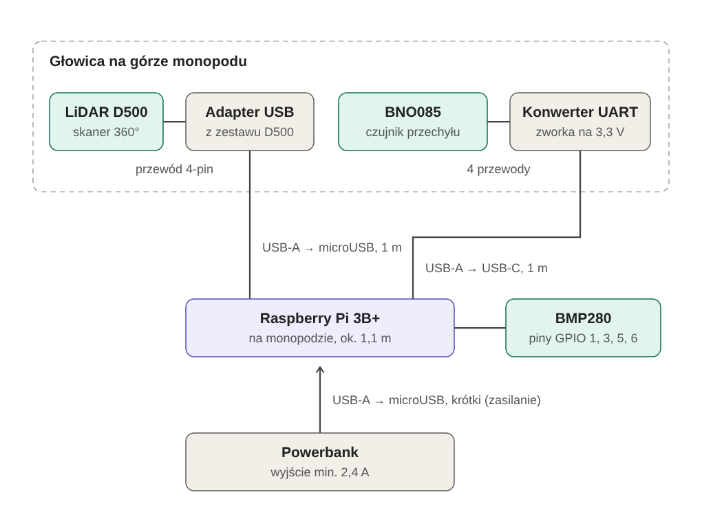

# GOLlidar

Rejestrator do skanowania wnętrz budynków LiDAR-em 2D na Raspberry Pi, z podglądem i sterowaniem z telefonu.

Zestaw: LiDAR D500 (LDROBOT STL-19P / LD19), IMU BNO085 w trybie UART-RVC, barometr BMP280, Raspberry Pi 3B+.

| Plik | Do czego |
|---|---|
| `skan_web.py` | Rejestrator z podglądem w przeglądarce (port 8080): bieżący obrót LiDAR-u, przechył, wysokość, START/STOP, znaczniki |
| `skan_log.py` | Rejestrator sterowany z terminala (wariant zapasowy) |
| `sprawdz.py` | Kontrola nagrania: pakiety, obroty, zasięg, przechyły, wykryte poziomy |
| `skaner.service` | Autostart `skan_web.py` po włączeniu zasilania (systemd) |
| `INSTRUKCJA.md` | Schemat połączeń, montaż głowicy, instalacja, obsługa strony, sposób chodzenia |
| `start.sh` | Zamyka starą kopię, pobiera aktualizacje i uruchamia rejestrator |
| `obudowa/` | Pliki STL głowicy do druku 3D (gwint 1/4") i generator |
| `dokumentacja/` | Schemat połączeń i rysunki |



Szybki start:

```bash
sudo apt install -y python3-serial python3-smbus2 python3-matplotlib i2c-tools tmux git
git clone https://github.com/Anakreont/GOLlidar.git ~/skaner
cd ~/skaner && python3 skan_web.py
```

Potem w telefonie: `http://<adres-IP-raspberry>:8080`.

Nagrania trafiają do `~/skany/` jako surowe bajty z czujników ze znacznikami czasu; mapę liczy się z nich później.
Katalog z nagraniami jest wyłączony z repozytorium (`.gitignore`).
